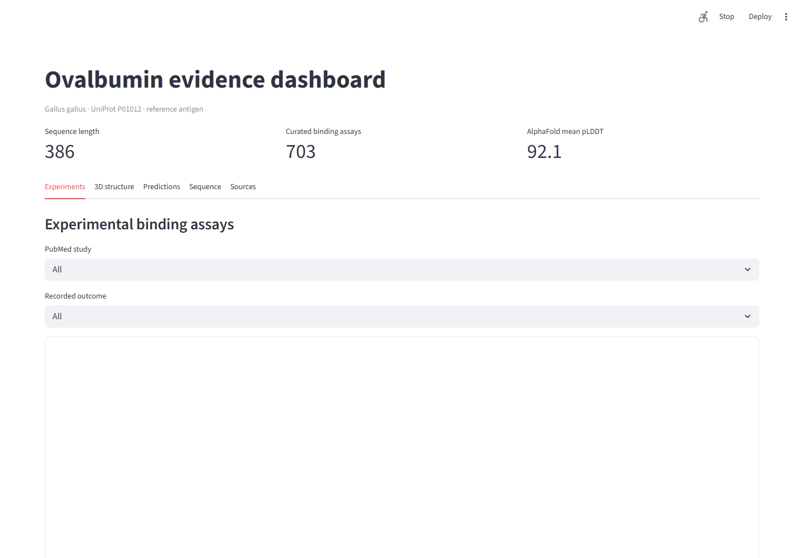

# Ovalbumin evidence dashboard

**How can published evidence for a reference protein be explored alongside structure and predictions?**

A Streamlit app combines canonical chicken ovalbumin sequence, aligned predicted and experimental structures, source-linked IEDB assays and separate predictor tracks. Browse assays by study and recorded result.

## Results

The dashboard packages **386 reference residues**, **373 mapped crystal residues** and **703 experimental assay rows** from three studies. See [snapshot counts](results/summary.json).



[3D structure view](results/structure_app.png)

## Methods

Sanity-check that the sequence, structural mapping and prediction coordinates agree, and that each experiment has a unique assay ID and an indexed paper. The app displays BepiPred 2.0, Parker and Emini as within-protein percentiles. The structure panel displays AlphaFold v6 and crystallographic 1OVA chain C with a pLDDT profile.

## Reproduce

Use Python 3.12 in this repository.

```powershell
python -m venv .venv
.\.venv\Scripts\python -m pip install -r requirements.txt
.\.venv\Scripts\python analysis.py
.\.venv\Scripts\python -m unittest discover -v
```

On macOS and Linux, use `.venv/bin/python` in place of the Windows executable.
The analysis uses the snapshot included in `data/`.

Start the interface with `python -m streamlit run app.py`. Results in the repository are ready to explore after installing the requirements. The downloadable 3D view loads the 3Dmol.js renderer in the browser.

## Interpretation

The experiment panel covers a curated subset of published IEDB assays for chicken ovalbumin. Prediction scores represent within-protein ranks. Studies differ in their assay methods, hosts and antibodies.

## Sources and licenses

[UniProt P01012](https://www.uniprot.org/uniprotkb/P01012/entry) · [AlphaFold AF-P01012-F1](https://alphafold.ebi.ac.uk/entry/P01012) · [RCSB 1OVA](https://www.rcsb.org/structure/1OVA) · [IEDB Query API](https://query-api.iedb.org/docs/swagger/) · [IEDB prediction tools](https://tools.iedb.org/bcell/)

Input URLs and hashes are recorded in [data/sources.json](data/sources.json). The MIT license applies to this repository's code. Original datasets, structures and external scores retain their source terms.
